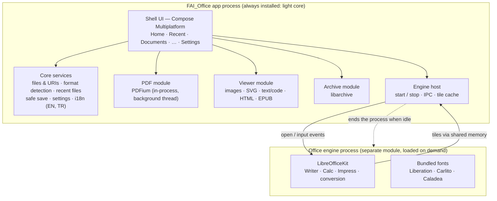

# FAI_Office — Phase 1 Technical Architecture Proposal

Status: **draft for owner review** (2026-11-18). Answers MASTER_SPEC section 15. Every number below comes from a
proof of concept in `poc/`; raw results and method are in `poc/RESULTS.md`, the license audit in
`poc/LICENSE_AUDIT.md`. Anything not measured is marked *proposed* or *open*.

Measurement devices: Android numbers come from a **Samsung Galaxy A55** (Exynos 1480, 8 GB, Android 16,
1080x2340 at 120 Hz), which is **not** the 4 GB reference device of section 7. Linux numbers come from a
development PC under WSLg. Both limits are repeated where they matter.

Pending: the office engine as WebAssembly (WP7) is building; section 8 and the Web parts of sections 1, 7 and 10
are filled in when it is measured.

---

## Summary

* **Engines: both candidates pass.** PDFium and LibreOffice core (through LibreOfficeKit) work on Android, Linux
  and in the browser (PDFium; LibreOffice in the browser pending), meet every measured time budget with a wide
  margin, and pass the section 11 license gate.
* **The office engine must run in its own process.** LibreOfficeKit does not give memory back when documents
  close and cannot be torn down in-process. On Android, an engine process that ends when idle returns all of its
  ~220 MB; this is how "idle engines are unloaded" (section 3) is met.
* **Shell: Compose Multiplatform is recommended, with one condition.** It is the only candidate that meets the
  Android memory budgets (36 MB at rest vs Flutter's 256 MB). Flutter is lighter on Linux and Web. The condition:
  the 4 GB reference phone must confirm the Android numbers before Phase 2 starts.
* **Budgets:** all time budgets are confirmed; two RAM budgets need a definition (what is counted) and one viewer
  design rule; two new budgets are proposed (Linux package, desktop RAM).

---

## 1. Recommended technology stack

| Layer | Choice | Why (evidence) |
|---|---|---|
| Shell / UI, all platforms | **Compose Multiplatform** (Kotlin): Jetpack Compose on Android, Compose for Desktop (JVM) on Linux / Windows / macOS, Compose on Kotlin/Wasm for Web; iOS later | Android: 36 MB PSS at rest, 7.9 MB APK with PDFium, first frame 139 ms (WP8). Linux: first frame 1.13 s, inside 1.5 s. Web: 4.06 MB initial load (PDFium loaded on first PDF open). One code base. See section 10 for the comparison with Flutter. |
| PDF engine | **PDFium** (prebuilt, pinned) | First page 84–146 ms on the phone, 9 ms on Linux, 43 ms in the browser; 6.3 MB per ABI, 2.4 MB gzip for Web (PoC-1, PoC-2, WP5, WP8). |
| Office engine | **LibreOffice core via LibreOfficeKit**, MPL subset, in a separate process | 20-page DOCX on the phone: 0.87 s cold, 0.6–0.8 s warm; 83 MB module download (WP6). |
| Engine ↔ shell | Android: bound service in its own process, tiles through `SharedMemory`. Desktop: child process, tiles through shared memory. Web: engine in its own Web Worker(s) | WP6: bind 55 ms, process start 15 ms, memory fully returned on exit. |
| Native glue | Small C bridges (JNI on Android / JVM, JS interop on Web) | 50-line JNI bridge for PDFium in WP8. |
| Archives | *proposed:* libarchive (BSD-2) for ZIP / 7Z / TAR and read-only RAR | Not built yet; Phase 5 PoC. |
| Fonts | Liberation (OFL), Carlito (OFL), Caladea (Apache-2.0) bundled with the office engine (8 MB); Noto on demand | Bundled and used in WP6. |
| Build | Gradle (app), Docker images for the LibreOffice Android and WASM builds | `poc/lo-android/`, `poc/lo-wasm/`. |

## 2. Architecture diagram



On Web the same split holds: the shell and PDFium run on the page (PDFium loaded on first PDF open), and the
office engine runs in Web Workers loaded on first office document.

## 3. Application structure

*Proposed* repository layout for Phase 2 (product code replaces `poc/`, which stays as reference):

```
app/                    Compose Multiplatform application
  src/commonMain/       screens, navigation, design system, view models
  src/androidMain/      Android entry, engine service binding, SAF / content URIs
  src/desktopMain/      Linux / Windows / macOS entry, engine child process
  src/wasmJsMain/       Web entry, workers, File System Access / download
core/                   shared services (Kotlin Multiplatform): files, format detection, recent files,
                        safe save, settings, localisation
engines/pdf/            PDFium bindings: JNI (Android, JVM), JS interop (Wasm)
engines/office/         engine host + IPC protocol (shell side) and engine service (engine side)
engines/viewer/         image, SVG, text, HTML, EPUB viewers
engines/archive/        libarchive bindings
build/                  pinned third-party builds: pdfium, lo-android, lo-wasm (Docker), fonts
corpus/                 fidelity corpus and reference renders (section 9)
tests/                  corpus tests, budget tests (run on device in CI)
THIRD_PARTY_NOTICES     generated from the actual build (section 11)
```

## 4. Module architecture and delivery per platform

| Module | Contents | Runs in | Android (Play) | Android (F-Droid / APK) | Linux | Web |
|---|---|---|---|---|---|---|
| Light core | shell, core services, PDF, viewer, archive | app process | base module | in the APK | in the package | initial load (PDFium on first PDF) |
| Office engine | LibreOfficeKit, filters, fonts | own process / workers | on-demand feature module | same APK ("full") | bundled, or Flatpak extension (section 10) | fetched on first office document, cached |

Rules carried over from section 3: a full offline build always exists for Android and Linux; the user sees the
size and confirms before any download; nothing downloads silently.

Measured so far: the "full" Android variant (engine inside the same APK) works. Play on-demand delivery of the
~200 MB native library is **not tested** (risk R4).

## 5. File format compatibility matrix (expected level per release)

Levels: 1 = open and view, 2 = edit and save, 3 = high-fidelity preservation. A level is claimed only after its
corpus tests pass (section 5 of the spec). "PoC" = opened and rendered in a proof of concept, not yet tested
against the corpus.

| Format | Phase 1 PoC | R1 | R2 | R3 | R4 | R5 (Web) |
|---|---|---|---|---|---|---|
| PDF | rendered (PDFium) | 1 + annotations, forms, page ops | = | = | = | 1 |
| DOCX | opened (LOK, phone + Linux) | 1 | 2 | 2 | 2 | 1 (2 if engine fits, section 10) |
| ODT | opened (Linux) | 1 | 2 | 2 | 2 | as DOCX |
| RTF, TXT | — | 1 | 2 | 2 | 2 | as DOCX |
| DOC (legacy) | — | 1 | engine level, tested | = | = | as DOCX |
| XLSX | opened, formulas computed | 1 | 1 | 2 | 2 | 1 |
| ODS, CSV | ODS opened | 1 | 1 | 2 | 2 | 1 |
| XLS (legacy) | — | 1 | 1 | engine level | = | 1 |
| PPTX | opened | 1 | 1 | 1 | 2 + presentation mode | 1 |
| ODP | opened | 1 | 1 | 1 | 2 | 1 |
| PPT (legacy) | — | 1 | 1 | 1 | engine level | 1 |
| Images, SVG, text, HTML, XML, EPUB | — | 1 | = | = | = | 1 |
| ZIP, 7Z, TAR | — | browse + extract | = | = | = | browse + extract |
| RAR | — | browse + extract (read-only) | = | = | = | = |

Level 3 is not promised for any release yet; it is set per format after the corpus thresholds (section 9) are
measured in Phase 6.

## 6. Recommended libraries and section 11 audit result

| Library | License | Audit result |
|---|---|---|
| PDFium (chromium/8111) + bundled components | BSD-3; Apache-2.0, MIT, BSD, FTL, Unicode, zlib, libpng | **pass** |
| LibreOffice core 26.8.2 | MPL-2.0 (OpenOffice.org parts Apache-2.0) | **pass, with removals** |
| LibreOffice bundled components that violate the policy: poppler (GPL), GPGME / libassuan / libgpg-error (LGPL), MariaDB C (LGPL), Firebird (IPL), lpsolve (LGPL), CoinMP (CPL), Java parts, Culmus fonts (GPL), GPL / LGPL / CC-BY-SA icon themes, GPL dictionaries | — | **removed** by configure switches; the Android target builds the MPL subset by itself; CoinMP needs two one-line patches (`poc/lo-android/build.sh`). Verified on the built Android library. |
| Hunspell, Hyphen, cairo (MPL-1.1 / LGPL / GPL choices) | MPL-1.1, upgradeable to MPL-2.0 | **pass with written justification** (needed for spell check and on Android) |
| Liberation, Carlito, Noto fonts | OFL-1.1 | pass |
| Caladea font | Apache-2.0 | pass |
| Compose Multiplatform, Kotlin, AndroidX | Apache-2.0 | pass (not yet in the notice-file audit) |
| Flutter (alternative shell) | BSD-3 | pass |
| libarchive (proposed) | BSD-2 | to audit in Phase 5 |

Obligations: one generated third-party notice file; no third-party trademarks in names; MPL file-level source
publication for modified MPL files; FreeType credit line.

## 7. Android / Linux / Web implementation strategy

**Android (priority 1).** Jetpack Compose UI. PDFium in-process through JNI on a single background thread,
bitmaps uploaded ahead of drawing. Office engine as a bound service in a separate process; the shell owns the
tile cache and ends the engine when idle (proposed: 60 s without an open document, immediately under memory
pressure). Assets of the engine are extracted once at first engine start (49 ms). Play: base + on-demand feature
module; F-Droid / APK: full variant. CI from Phase 2 runs budget tests on a physical 4 GB phone.

**Linux (priority 2).** Compose for Desktop on a jlink'ed JVM. PDFium as a shared library; office engine as a
child process (same IPC protocol as Android, shared memory for tiles). Packaging: see section 10.

**Web (priority 3, release R5).** Compose on Kotlin/Wasm. Initial load: shell only (4.06 MB gzip measured); PDFium
WASM (2.4 MB) on first PDF open; office engine WASM on first office document, cached by the browser, after the
user sees the size. Must be served cross-origin isolated (COOP/COEP) for the engine's threads. No server-side
processing. Office scope on Web depends on WP7 (section 10).

## 8. Proof-of-concept results against section 7 budgets

| Budget (section 7) | Provisional | Measured | Proposal |
|---|---|---|---|
| Android base download (light core, one ABI) | ≤ 30 MB | shell + PDFium APK: Compose 7.9 MB, Flutter 21.3 MB | **confirm 30 MB** (viewer, archive, UI still to come) |
| Office engine module (one ABI) | ≤ 120 MB | 83 MB deflate (LibreOffice build), 81 MB gzip with fonts (harness APK); not trimmed yet | **confirm 120 MB** |
| Cold start to usable Home | ≤ 1.5 s | Android first frame: Compose 139 ms, Flutter 207 ms; Linux: Compose 1.13 s, Flutter 260 ms | **confirm 1.5 s**, on Android and Linux |
| 100-page PDF, first page visible | ≤ 1 s | phone 84–146 ms; Linux 9 ms; browser 43 ms | **confirm 1 s** (keep margin for 4 GB device) |
| Typical 20-page DOCX, engine not loaded | ≤ 5 s | phone 0.87 s (first run after install 1.14 s); Linux 0.58 s | confirm 5 s now; **propose 3 s** after the 4 GB device and Microsoft-produced corpus files are measured |
| Typical 20-page DOCX, engine loaded | ≤ 2 s | phone 0.62–0.78 s; Linux 0.23–0.30 s | **confirm 2 s** |
| RAM on Home, no document | ≤ 150 MB | PSS incl. graphics: Compose 36 MB, Flutter 256 MB (Impeller holds ~150 MB GPU memory), Flutter-Skia 111 MB | **confirm 150 MB, defined as Android PSS including graphics** |
| RAM while viewing a PDF | ≤ 300 MB | peak PSS while scrolling 101 pages: Compose 319, Flutter 392, Flutter-Skia 303 — dominated by the PoC's 12-page full-bitmap cache | **confirm 300 MB** plus a viewer rule: decoded page/tile cache ≤ 64 MB, one copy (GPU only) |
| RAM while editing a typical document | ≤ 600 MB | viewing: engine process 209–228 MB + UI 93–109 MB; editing not measured | keep 600 MB; measure in Phase 7 |
| Web initial load, light core, compressed | ≤ 5 MB | Compose 4.06 MB (+ PDFium 2.4 MB on first PDF), Flutter Wasm 2.19 MB (4.6 MB with PDFium) | **confirm 5 MB**, PDFium excluded from the initial load |
| Web office engine download | measure | 76.8 MB gzip (untrimmed; ~55–60 MB after font/UI trimming); UNO ready in 11.4 s locally; >1 GB memory; document open not yet working | *propose* ≤ 60 MB gzip, loaded only on demand; scope decision below |
| *new:* Linux package, light core | — | shell only: Compose 115 MB (JVM 77 MB), Flutter 22 MB | *propose* ≤ 150 MB installed, after a native-Linux measurement |
| *new:* Desktop RAM at rest | — | ~225–275 MB under WSLg (not representative) | *propose* after a native-Linux measurement |

Scroll smoothness (no budget in section 7): measured with SurfaceFlinger on the phone, all shells present every
frame on time while scrolling 101 PDF pages at 120 Hz (0–9 janky frames out of ~3 600), with no visible page ever
blank. *Propose* adding "≤ 1 % janky frames while scrolling" as a budget.

## 9. Fidelity test plan

**Corpus** (in the repository, every file freely redistributable):

| Group | Source | Size target |
|---|---|---|
| Generated | `poc/corpus/gen.py`: structure-controlled DOCX / ODT / XLSX / ODS / PPTX / ODP / PDF, EN + TR text (exists) | ~20 files |
| Authored in Microsoft Office | written by the project in Word / Excel / PowerPoint, released CC0; covers styles, tables, headers/footers, fields, tracked changes, comments, charts, pivot tables, conditional formatting, slide masters, transitions, embedded fonts | ~60 files |
| Public-domain real documents | e.g. US federal government documents (public domain by law), selected and recorded with their source | ~30 files |
| Scripts | Arabic, Hebrew (RTL), Chinese, Japanese, Korean (CJK), Turkish; Noto fonts (OFL) | ~10 files |
| PDF specifics | forms, annotations, PDF/A, encrypted, scanned images, 500+ pages | ~15 files |
| Hostile / broken | truncated, malformed, zip bombs (bounded), huge images | ~10 files |

The "typical documents" of section 7 are named files in this corpus (today: `typical-20p.docx`, `typical.xlsx`,
`typical.pptx`, `long-100p.pdf`).

**Reference renders:** OOXML → PDF exported from Microsoft Office (owner's machine, pinned version recorded);
ODF → PDF exported from LibreOffice desktop (pinned version). Stored next to each corpus file.

**Automated checks per file** (proposed thresholds; calibrated on the corpus in Phase 6, then frozen):

| Check | Level 1 | Level 3 |
|---|---|---|
| Page count equals reference | required | required |
| Extracted text, normalized, per page: similarity to reference | ≥ 0.98 | ≥ 0.995 |
| Visual similarity per page (SSIM on 100 dpi greyscale renders) | ≥ 0.90 | ≥ 0.97 |
| Round trip (open, save, reopen): text and page count unchanged | — (Level 2: required) | required |
| Round trip: elements the app does not understand survive (XML part diff) | — | required |
| Font substitution reported to the user when it happens | required | required |

A format moves up a level only when every file of its group passes. Results feed the compatibility matrix
automatically.

## 10. Open choices: options compared

### Shell framework

| | Compose Multiplatform | Flutter |
|---|---|---|
| Android RAM at rest (PSS) | **36 MB** | 256 MB (Impeller), 111 MB (Skia, deprecated) |
| Android APK, shell + PDFium | **7.9 MB** | 21.3 MB |
| Android first frame | **139 ms** | 207 ms |
| Scrolling (display-level janky frames) | 9 / 3 635 | 0 / 3 634 |
| Linux package | 115 MB (JVM) | **22 MB** |
| Linux first frame | 1.13 s | **260 ms** |
| Web initial load (shell) | 4.06 MB | **2.19 MB** (Wasm) |
| Web: off-origin requests by default | none | renderer + Roboto from Google CDN unless `--no-web-resources-cdn` |
| Engine-tile display | `Bitmap` / `ImageBitmap`, JNI | `RawImage`, FFI |
| License | Apache-2.0 | BSD-3 |

**Recommendation: Compose Multiplatform.** Reasoning: Android is the first platform and the main constraint is
the light core's memory on a 4 GB phone; Compose meets the 150 MB home budget with room to spare, Flutter misses
it by 100 MB before doing anything. Compose's costs (JVM on Linux, larger Web load) still fit the measured
budgets: 1.13 s start against 1.5 s, and 4.06 MB against 5 MB with PDFium loaded on demand.
**What would change the recommendation:** the 4 GB reference phone shows Impeller's baseline far below 150 MB
(the ~150 MB may be specific to the A55's Xclipse GPU), or the owner weighs Linux package size above Android
memory.

### Office engine delivery on Web

WP7 part 1 (`poc/RESULTS.md`): the engine starts in the browser (76.8 MB gzip, 11.4 s to UNO ready, >1 GB memory); opening a document via JS UNO still fails. Options: (a) full LibreOffice WASM engine fetched on first office document
and cached; (b) reduced office scope on Web (view-only, or Writer only via `--with-wasm-module=writer`) with the
compatibility matrix saying so; a server fallback is not an option (section 9).

### Linux packaging

| | Flatpak (core) + Flatpak extension (engine) | AppImage / tarball, everything bundled | Distribution .deb / .rpm |
|---|---|---|---|
| One product, optional engine | **yes** (extension installed on demand, size shown) | engine always included | split packages possible |
| "Full offline build" rule | needs a second, full build | **is** the full build | yes |
| Sandboxing, updates | sandboxed, Flathub updates | none, manual | distro |
| Effort for one developer | medium | **low** | high (per distro) |

**Recommendation:** Flatpak on Flathub with the office engine as an extension, plus a full AppImage as the
always-available offline build. Not measured; to be validated in Phase 2 CI.

## 11. Main technical risks with go / no-go criteria

| # | Risk | Go / no-go criterion | Status |
|---|---|---|---|
| R1 | Shell memory on the 4 GB reference phone | Go if Home PSS ≤ 150 MB and PDF viewing ≤ 300 MB on that phone | open: phone not yet available |
| R2 | Office engine size grows with fonts / filters | Go if the engine module stays ≤ 120 MB download per ABI | 81–83 MB measured |
| R3 | Office engine in the browser is too large or slow | Go for full office scope on Web if the trimmed engine is ≤ 60 MB gzip, opens the typical DOCX in ≤ 10 s on a mid laptop and stays < 1.5 GB; otherwise reduced scope | engine starts (76.8 MB, 11.4 s, >1 GB); document open not working yet |
| R4 | Play on-demand delivery of a ~200 MB native library | Go if a `bundletool` local test installs the engine module on demand and it starts | not tested |
| R5 | Fidelity on Microsoft-produced documents | Go for R1 if ≥ 95 % of the corpus passes Level 1 thresholds | corpus not built |
| R6 | Engine process IPC latency for editing | Go for R2 if a tile round trip after a key press is ≤ 50 ms on the reference phone | not measured |
| R7 | JVM start on Linux | Go if Compose desktop first frame ≤ 1.5 s on a native mid-range Linux laptop | 1.13 s under WSLg |
| R8 | Kotlin/Wasm and Compose for Web maturity | Go if the Web build compiles and runs the light core in CI from Phase 2 | builds and renders (shell PoC) |
| R9 | LibreOffice integration patches (CoinMP, Java bridge, fonts.conf) must be carried on every update | Go if all patches are scripted and applied in CI | scripted in `poc/` |
| R10 | One developer + AI agents: scope | Phases gate on acceptance criteria; R1 only (no R2+ work before it ships) | process |

## 12. Development phases and dependencies

| Phase | Content | Depends on | Release |
|---|---|---|---|
| 1 | Architecture, PoCs, license audit, budgets (this document) | — | — |
| 2 | Compose shell, navigation, design system (`DESIGN.md`), i18n EN/TR; CI for Android + Linux, Web build of the core; budget tests on the reference phone | 1 approved; reference phone | — |
| 3 | File management (SAF / content URIs, desktop files, browser File System Access), format detection, recent files, safe-save layer | 2 | — |
| 4 | PDF module: viewing, search, selection, annotations, forms, page ops, merge/split, print | 2, 3 | — |
| 5 | Viewer and Archive modules (libarchive PoC + audit first) | 2, 3 | — |
| 6 | Office engine integration: engine process + IPC on Android and Linux, module delivery (Play feature module, Flatpak extension), Level 1 viewing of all office formats, conversion; fidelity corpus and CI | 3; LibreOffice build pipeline from `poc/` | **R1** (Android, Linux) |
| 7 | Writer editing (Level 2) | 6 | **R2** |
| 8 | Sheets editing (Level 2) | 6 | **R3** |
| 9 | Slides editing, presentation mode | 6 | **R4** |
| 10 | Web version: Kotlin/Wasm shell, PDFium WASM, office engine WASM (scope per WP7) | 2–6 | **R5** |
| 11 | Windows, iOS, macOS adaptation | 2–9 | **R6** |

Phases 4 and 5 can run in parallel after 3. Nothing from Phase 7 onward may delay R1.

---

## Owner decisions requested at the Phase 1 review

1. Shell framework: Compose Multiplatform (recommended) or Flutter.
2. Budget definitions: RAM as Android PSS including graphics; the PDF viewer cache rule; the proposed new
   budgets (Linux package, desktop RAM, scroll janky frames).
3. Linux packaging: Flatpak + extension, plus a full AppImage.
4. Acquire the 4 GB reference phone (exact model to be fixed) before Phase 2.
5. Office scope on Web: decided after WP7 (pending).
